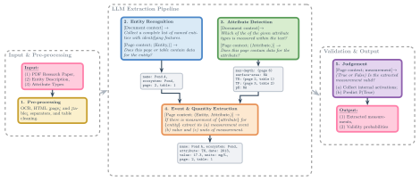

# ScholarlM :microscope: :books:

[](https://github.com/kevinqnb/scholarlm/actions/workflows/signoff.yml)

Extract structured (entity, attribute, value) measurements from scientific PDFs using large language models.
Runs local open-weight models via vLLM or frontier APIs (OpenAI / Gemini).

Core capabilities:
- **Document OCR** — convert PDF pages to markdown text with HTML table extraction
- **Measurement extraction** — a seven-step LLM pipeline (entities → attributes → provenance → events → values → standardization → deduplication), plus ablations and baselines (GLiNER, NuExtract, ChatExtract, LangExtract)
- **Judgement** — LLM judges (vLLM or NNsight) assign validity scores to extracted data; a probe on judge activations gives calibrated confidence

<div align="center">
  
</div>

## Installation

**Prerequisites:** Python 3.11–3.12; a GPU for local inference (vLLM / transformers / nnsight).

```bash
git clone https://github.com/kevinqnb/scholarlm.git
cd scholarlm

uv sync                  # core install
uv sync --extra gpu      # + local GPU inference (vLLM / nnsight)
uv sync --extra dev      # + pytest / notebook tooling
```

Run tests with `uv run --extra dev pytest`. Cluster runs additionally need the environment variables listed in [CLAUDE.md](CLAUDE.md).

## Repo layout

| Path | Contents |
|---|---|
| `src/scholarlm/` | Core library: `measurementlm.py` (pipeline), `measurementlm_ablation*.py`, baselines, `judgementlm.py`, `documentlm.py` (OCR), `instruction_prompts.py`, `config.py` |
| `experiments/` | Runner scripts (`run_*.py`), `submit.sh` for SGE, and all configs — see [experiments/README.md](experiments/README.md) |
| `analysis/` | Config-driven analysis scripts (recovery/validity, calibration, meta-analysis, …) — see [analysis/README.md](analysis/README.md) |
| `data/{pond,nfix,supermat,measeval}/` | Per-dataset paper registry, ground truth, preprocessing, and probe datasets (each has a README) |
| `data/validation/` | Builders for the manual-validation sets |
| `tests/` | Unit tests |
| `devlog/` | Record of AI-assisted build/experiment work |

## Data

We do not share the PDFs used in our experiments, but each dataset's papers are documented by title, author, and identifying information in `data/<dataset>/directory.json` ([pond](data/pond/directory.json), [nfix](data/nfix/directory.json), [supermat](data/supermat/directory.json), [measeval](data/measeval/directory.json)). Sources for each dataset:
1. Richardson, David C., et al. "A functional definition to distinguish ponds from lakes and wetlands." Scientific reports 12.1 (2022): 10472.
2. Fulweiler, Robinson W., et al. "A global dataset of nitrogen fixation rates across inland and coastal waters." Limnology and oceanography letters 10.3 (2025): 412-429.
3. Foppiano, Luca, et al. "SuperMat: construction of a linked annotated dataset from superconductors-related publications." Science and Technology of Advanced Materials: Methods 1.1 (2021): 34-44. (supermat; [arXiv:2101.02455](https://arxiv.org/abs/2101.02455))
4. Harper, Corey, et al. "SemEval-2021 Task 8: MeasEval – Extracting Counts and Measurements and their Related Contexts." Proceedings of the 15th International Workshop on Semantic Evaluation (SemEval-2021) (2021): 306-316. (measeval; [data](https://github.com/harperco/MeasEval))

Reviewed ground truth, used for comparison against extracted data: [pond](data/pond/ground_truth_review.json) and [nfix](data/nfix/ground_truth_review.json). Supermat and MeasEval ground truth are `ground_truth.json` in their directories. Run outputs are gitignored under `experiments/results/`.

## Prompts, Schemas, and Configs

- Prompts: [`src/scholarlm/instruction_prompts.py`](src/scholarlm/instruction_prompts.py)
- Dataset schemas: [`experiments/dataset-configs/`](experiments/dataset-configs/) (`pond.py`, `nfix.py`, `supermat.py`, `measeval.py`)
- Models (parameters, source repos, serve and GPU settings): one YAML per model under [`experiments/model-configs/{kind}/`](experiments/model-configs/)
- Experiments: one committed YAML per run at `experiments/experiment-configs/{dataset}/{type}/<id>/<id>.yaml`

## Experiments

See [experiments/README.md](experiments/README.md) for the full workflow. Every runner takes one config path and no override flags.

```bash
# Extract
python experiments/run_extraction.py experiments/experiment-configs/pond/extraction/<id>/<id>.yaml

# Judge with a local model
python experiments/run_judge_local.py experiments/experiment-configs/pond/judge_local/<id>/<id>.yaml

# Judge and collect model activations (attention head & layer output)
python experiments/run_judge_interp.py experiments/experiment-configs/pond/judge_interp/<id>/<id>.yaml

# Or submit any of the above to SGE
bash experiments/submit.sh <id> [--dry-run]
```

Analysis: `python analysis/<script>.py analysis/analysis-configs/<type>/<id>.yaml`.

## Development log

Much of the experiment and build work in this repo is done with AI coding
assistance. [`devlog/`](devlog/) records it: one file per experiment/build id
(`YYYY-MM-DD-slug-NN`, the same id as the experiment's config), pairing the
human-written prompts that drove the work with a short summary of what landed and
the commits that carry it. See [`devlog/README.md`](devlog/README.md) for the format.

## License

MIT — see [LICENSE](LICENSE).
